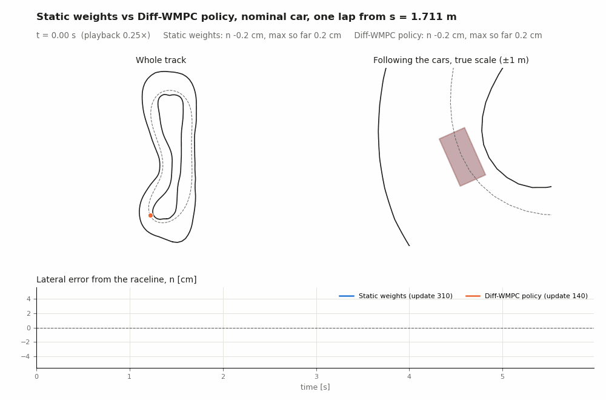
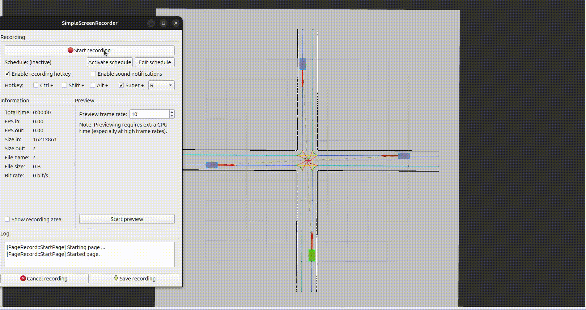
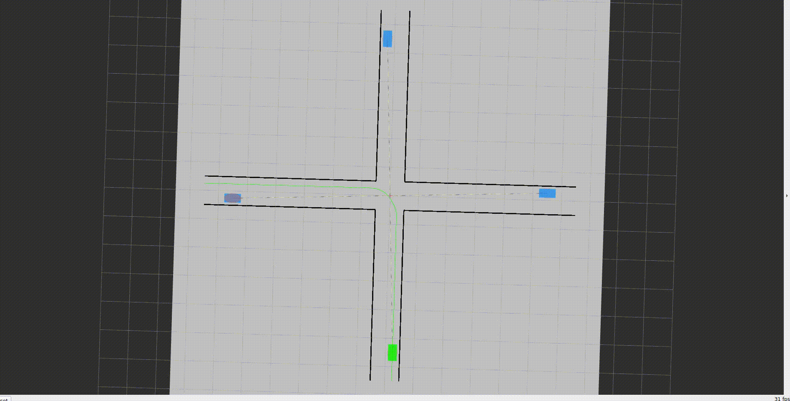
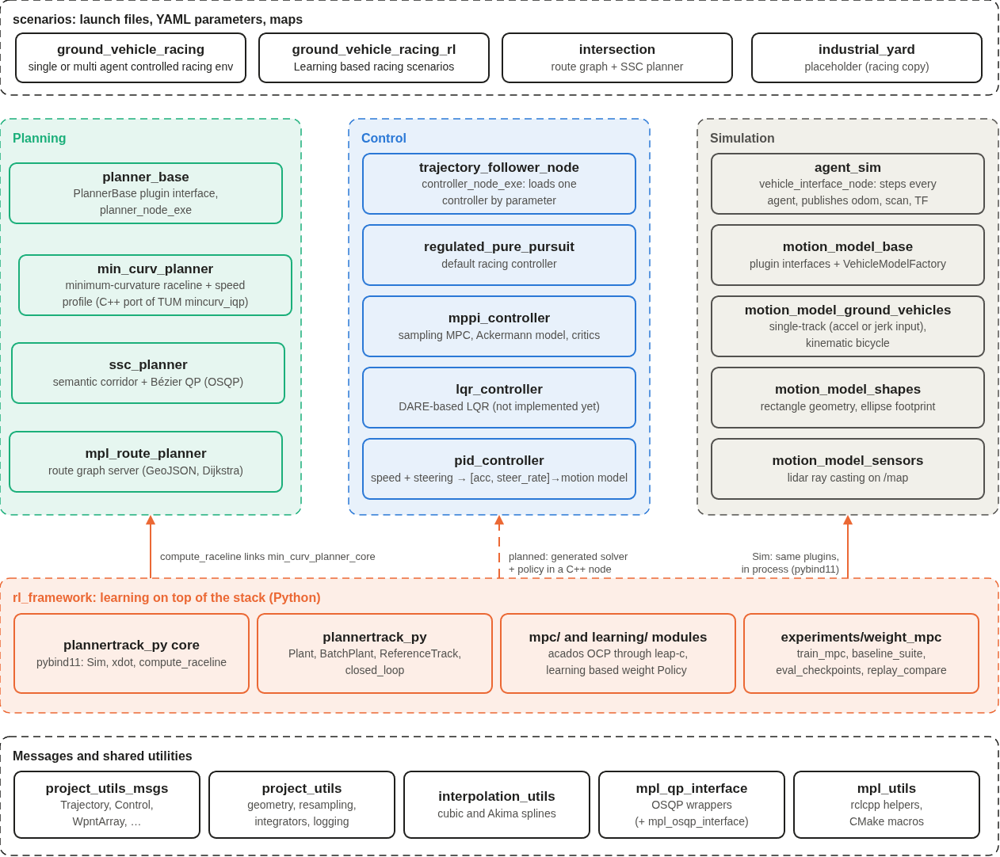
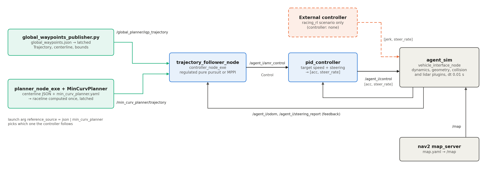
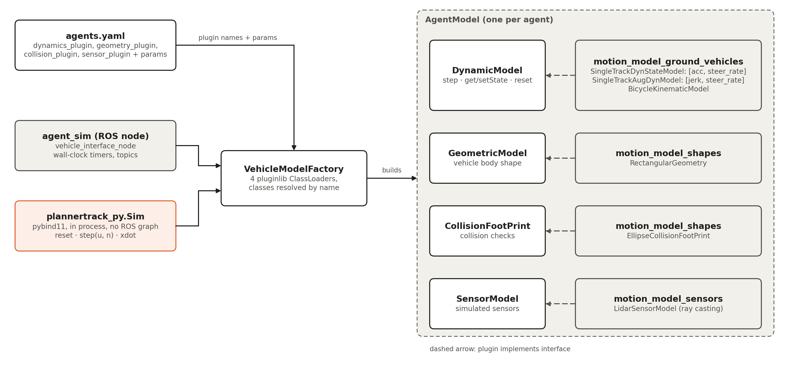
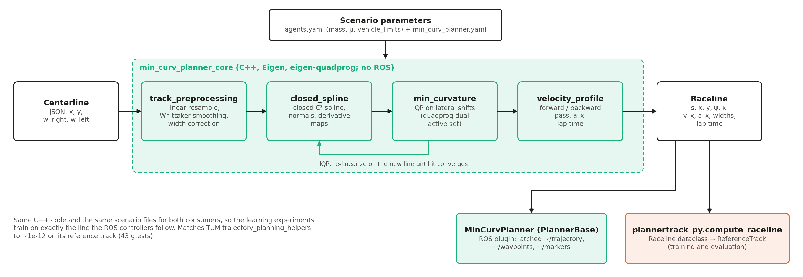

<!-- Author: Prajwal Thakur <prajwalthakur98@gmail.com> -->

# PlannerTrack


*Dynamic obstacle avoidance through a vanilla MPPI controller
— [full demo on YouTube](https://www.youtube.com/watch?v=Jcm3qd_RIX4).*

PlannerTrack is a ROS 2 (C++) framework for multi-agent planning and control of ground vehicles. It includes a
plugin-based vehicle simulator, planners, trajectory-tracking controllers and YAML-configured scenarios. On top of it,
`rl_framework` adds learning-based control in Python. It reuses the same C++ simulator and raceline planner in process
through pybind11, so experiments run faster than real time without a ROS graph.

> **Featured — [Diff-WMPC: a controller that learns to retune itself while driving](workspace/ros_ws/src/rl_framework/experiments/diff_weight_mpc/conclusion_policy_vs_static/architecture.md).**
> A small neural network adjusts the car controller's settings 50 times a second based on the road ahead. In
> simulation, the car stays on its intended path about twice as accurately as with the best fixed settings.

## Contents

- [Diff-WMPC](#recent-work-diff-wmpc)
- [Demos](#demos)
- [System overview](#system-overview)
- [Racing runtime](#racing-runtime)
- [Simulation plugins](#simulation-plugins)
- [Raceline pipeline](#raceline-pipeline)
- [Learning stack](#learning-stack)
- [Other scenarios](#other-scenarios)
- [Getting started](#getting-started)

## Recent Work: Diff-WMPC

*Learning time-varying MPC cost weights with a neural network policy.*



**Objective:** A Model Predictive Control (MPC) controller balances competing objectives, such as path tracking
accuracy, speed tracking and control smoothness, through a set of cost weights. These weights are conventionally
tuned by hand and held constant, which forces a compromise across driving conditions: weights suited to a straight
are suboptimal in a tight corner.

Diff-WMPC replaces the constant weights with a neural network policy that selects them at every control step
(50 Hz) from a preview of the upcoming track. The policy is trained in simulation by differentiating the
controller's performance with respect to the weights, which removes manual tuning. Compared with the best constant
weights, it reduces path tracking error by roughly half at the same lap time.

**Technical summary.**


A reimplementation of *Differentiable Weights-Varying Nonlinear MPC via Gradient-Based Policy Learning* (Jahncke et
al., IEEE RA-L 2026) on a small racing car in simulation:

- A 10 → 128 → 128 → 6 network reads 5 speeds and 5 curvatures of the track ahead and sets six cost weights of a
  nonlinear MPC (acados SQP-RTI, 34 × 0.075 s) at every 50 Hz control step.
- It is trained end to end: the task loss is backpropagated through the solver's sensitivities (leap-c) into the
  network, with one Adam update per lap.
- The car is the same C++ `SingleTrackAugDynModel` plugin the ROS simulator uses, called in process via pybind11.

Nominal car, 8 fixed starts, same starting weights, loss and seed:

| | Best static weights | Learned policy |
|---|---|---|
| RMS lateral error | 2.09 cm | **1.10 cm** |
| Smallest margin to the track edge | +5.28 cm | **+6.40 cm** |
| RMS speed error | 0.075 m/s | **0.061 m/s** |
| Lap time | 6.00 s | 6.00 s |
| RMS steering rate | **0.30 rad/s** | 0.70 rad/s |

One seed; the policy needs early stopping (best checkpoint at update 140).

**→ [Full write-up](workspace/ros_ws/src/rl_framework/experiments/diff_weight_mpc/conclusion_policy_vs_static/architecture.md)**:
policy network, MPC cost and constraints, loss, how the gradient reaches the policy, training settings, differences
from the paper and training curves.

## Demos

<!-- 

*4 agents crossing a simulated unprotected left-turn intersection. Each agent's route comes from a nav2-based
route planner (lifecycle-managed `route_server` + `map_server`) on the intersection's road graph.* -->



*Spatio-Temporal Semantic Corridor (SSC) planner: detect other agents' behavior → inflate a safe spatio-temporal
corridor around the ego route (`(s, d, t)` cubes, pictured) → fit a safe Bézier trajectory inside it. See
[ssc_planner/readme.md](workspace/ros_ws/src/planning/ssc_planner/readme.md) for a pass/fail comparison and why the
failure case is an architectural limitation (missing multi-policy decision layer).*

## System overview



The workspace has five layers:

| Layer | Role | Packages |
|---|---|---|
| Scenarios | Launch files, parameters and maps that wire one experiment together | [scenarios](workspace/ros_ws/src/scenarios) |
| Planning | Compute the path or trajectory a vehicle should follow | [min_curv_planner](workspace/ros_ws/src/planning/min_curv_planner), [planner_base](workspace/ros_ws/src/planning/planner_base), [ssc_planner](workspace/ros_ws/src/planning/ssc_planner), [mpl_route_planner](workspace/ros_ws/src/mpl_route_planner)|
| Control | Track that trajectory and command the vehicle | [trajectory_follower_node](workspace/ros_ws/src/controller/trajectory_follower_node), [regulated_pure_pursuit](workspace/ros_ws/src/controller/regulated_pure_pursuit), [mppi_controller](workspace/ros_ws/src/controller/mppi_controller), [lqr_controller](workspace/ros_ws/src/controller/lqr_controller), [pid_controller](workspace/ros_ws/src/controller/pid_controller) |
| Simulation | Step the vehicles and simulate their sensors | [agent_sim](workspace/ros_ws/src/agent_sim), [motion_model_base](workspace/ros_ws/src/motion_model_base), [motion_model_ground_vehicles](workspace/ros_ws/src/motion_model_ground_vehicles), [motion_model_shapes](workspace/ros_ws/src/motion_model_shapes), [motion_model_sensors](workspace/ros_ws/src/motion_model_sensors) |
| Learning | Learn parts of the controller in Python, against the same simulator and reference | [rl_framework](workspace/ros_ws/src/rl_framework) |

All layers share the custom interfaces in [project_utils_msgs](workspace/ros_ws/src/project_utils_msgs) (`Trajectory`,
`Control`, `WpntArray`, …) and the helpers in [project_utils](workspace/ros_ws/src/project_utils).

Two design choices recur throughout:

- **Plugins loaded by name.** Planners, vehicle dynamics, footprints and sensors are pluginlib classes selected
  in YAML. A scenario changes the vehicle model or the planner without recompiling the nodes that use them.
- **One implementation, two front ends.** The raceline optimizer and the vehicle models are plain C++ libraries.
  ROS nodes and the Python learning code both call the same code with the same scenario files, so a result in
  Python transfers to the ROS stack without a reimplementation gap.

## Racing runtime



`scenarios/ground_vehicle_racing` starts one controller chain per agent listed in `params/agents.yaml`:

1. **Reference trajectory.** The launch argument `reference_source` selects one of two sources:
   - `json`: `global_waypoints_publisher.py` publishes a precomputed raceline from `global_waypoints.json`.
   - `min_curv_planner`: `planner_node_exe` loads the `MinCurvPlanner` plugin, which computes the raceline at
     startup.

   Both topics are latched, so a controller that starts late still receives the trajectory.
2. **Tracking.** `trajectory_follower_node` loads one controller by parameter: regulated pure pursuit (the
   default) or MPPI. It publishes a target speed and steering command (`Control`).
3. **Low-level control.** `pid_controller` turns that command into the simulator input `[acc, steer_rate]`, using
   the measured speed and steering angle.
4. **Simulation.** `agent_sim` steps every agent with its dynamics plugin (`simTimeStep` 0.01 s). It publishes
   odometry, steering reports, lidar scans and TF, and reads the occupancy map from `nav2 map_server`.

`scenarios/ground_vehicle_racing_rl` is a scenario for learning based MPC, with two differences:

- The agent's plant is `SingleTrackAugDynModel`, whose inputs are jerk and steering rate.
- `controller: "none"` is set, so the launch starts no controller and an external node publishes
  `[jerk, steer_rate]` on `/agent_1/control`. The launch rejects pure pursuit and MPPI on this plant because they
  command acceleration.

## Simulation plugins



An agent is an `AgentModel` made of four plugins, each named in `agents.yaml` with its own parameters:

| Interface | Purpose | Implementations |
|---|---|---|
| `DynamicModel` | State propagation: `step`, `get/setState`, `reset` | `SingleTrackDynStateModel` (dynamic single-track, tanh-saturated tires, load transfer; input `[acc, steer_rate]`), `SingleTrackAugDynModel` (same physics with acceleration as a state; input `[jerk, steer_rate]`), `BicycleKinematicModel` |
| `GeometricModel` | Vehicle body shape | `RectangularGeometry` |
| `CollisionFootPrint` | Collision checks | `EllipseCollisionFootPrint` |
| `SensorModel` | Simulated sensors | `LidarSensorModel` (ray casting on the occupancy grid) |

`VehicleModelFactory` holds four pluginlib class loaders and resolves the classes by name at runtime. It has no
compile-time dependency on any implementation. Two hosts use the same factory:

- **`agent_sim`** steps the agents on wall-clock timers and talks over ROS topics.
- **`plannertrack_py.Sim`** is a pybind11 class exposing `reset`, `set_state`, `get_state`, `step(u, n)` and `xdot`.
  It steps one agent as fast as the CPU allows, at about 120–150k steps/s per core in a Release build.

## Raceline pipeline



`min_curv_planner` is a C++ port of the minimum-curvature raceline optimizer from TUM's
`trajectory_planning_helpers` (`mincurv_iqp`). The core library (`min_curv_planner_core`) has no ROS dependency:

1. **`track_preprocessing`:** resamples the centerline, smooths it (Whittaker) and corrects the track widths.
2. **`closed_spline`:** fits a closed C² spline and computes normals and the derivative maps the QP needs.
3. **`min_curvature`:** solves a QP for the lateral shift of every point that minimizes the squared curvature
   (Goldfarb–Idnani dual active set, `eigen-quadprog`). The iterated variant (IQP) re-fits the spline on the new
   line and solves again until it converges.
4. **`velocity_profile`:** forward and backward passes under the vehicle's acceleration limits give the speed
   profile, the longitudinal acceleration and the lap time.

The output (`Raceline`: s, x, y, ψ, κ, v_x, a_x, widths, lap time) goes to two consumers:

- **ROS:** the `MinCurvPlanner` plugin publishes it latched on `~/trajectory`, `~/waypoints` and `~/markers`.
- **Python:** `plannertrack_py.compute_raceline` returns it as a dataclass for training and evaluation.

The port matches the Python original to about 1e-12 on its reference track, and it also fixes a factor-2 error in
the original objective.

## Learning stack


The first application is **Diff-WMPC**, a reimplementation of *Differentiable Weights-Varying Nonlinear MPC via
Gradient-Based Policy Learning* (Jahncke et al., IEEE RA-L 2026). A small network reads the track ahead and sets
the cost weights of a nonlinear MPC at every control step. It is trained by differentiating through the MPC
solver.

| Module | Role |
|---|---|
| `plannertrack_py` core (C++) | pybind11 bindings: `Sim` and `compute_raceline` |
| `reference.ReferenceTrack` | Raceline queried by arc length: projection to (s, n), stage references for the MPC, the 5-speed + 5-curvature look-ahead for the policy |
| `plant.Plant`, `batch_plant.BatchPlant` | The car: the C++ `SingleTrackAugDynModel` with optional mass and μ perturbations, random starts on the reference and failure flags. `BatchPlant` steps B cars together |
| `diff_weight_mpc/mpc/` | The OCP (CasADi model, Frenet tracking errors, six learnable weights, hard bounds, soft track and friction limits) solved by acados SQP-RTI through leap-c's `AcadosDiffMpcTorch`. Plan: 34 steps × 0.075 s |
| `diff_weight_mpc/learning/` | `WeightPolicy` (10 → 128 → 128 → 6, positive outputs) and the task loss at node 1 of the plan |
| `diff_weight_mpc/closed_loop` | `rollout`: the single loop used for both training and evaluation. `compute_metrics` summarizes a logged episode |
| `diff_weight_mpc/utils/` | `train_mpc.py` (static weights or policy), `baseline_suite.py`, `eval_checkpoints.py`, `perturbation_sensitivity.py`, `replay_compare.py` (RViz replay) |

**One control step (0.02 s):**

1. The policy maps the look-ahead to six weights.
2. The MPC solves with those weights and applies its first input to the plant.
3. The loss scores the plan.
4. `backward()` accumulates the gradient through the solver's sensitivities into the policy.

Adam updates the policy once per lap. The plant parameters can differ from the MPC's nominal model, which is how
the mismatch experiments are set up.

The `diff_weight_mpc/` modules live under `rl_framework/experiments/`; the others are in `plannertrack_py`. Results
and the full design are in [Recent Work: Diff-WMPC](#recent-work-diff-wmpc).

## Getting started

Build the dev image and start a development container (workspace is bind-mounted, not baked into the image):

```bash
./scripts/.build/.build.sh
./scripts/.deploy/devel.sh        # CPU; pass -c explicitly if needed
```

Inside the container, build with `colcon` against ROS 2 Jazzy in the usual way
(`colcon build --packages-select <package>` from `/workspace/ros_ws`).

To run the racing demo:

```bash
ros2 launch scenarios ground_vehicle_racing.launch.py
```

## License

MIT

## Use case

I initiated this project to independently study algorithms and software development for autonomous vehicle systems.
This repository is also available for your personal use in studying, education, research, or development.

If this project supports your work or contributes to your tasks, please feel free to inform me by starring the
repository.

## Contribution

Any contribution by creating an issue or sending a pull request is welcome!

## Author

[Prajwal Thakur](https://github.com/prajwalthakur)

## Independent Work Declaration

PlannerTrack was initiated and developed independently by Prajwal Thakur
prior to current employment.

This project is maintained as a personal open-source initiative,
developed outside the scope of employment, using personal time and
equipment. It is based solely on publicly available research and
standard algorithms.

This repository does not contain any proprietary, confidential, or
employer-owned intellectual property.

## Acknowledgments

This project adapts code and build tooling from the
[Autoware](https://github.com/autowarefoundation) project (Apache License
2.0):

- **`interpolation_utils`** — interpolation algorithms (linear, spline,
  spherical linear, zero-order hold), adapted from Autoware's
  `interpolation_utils` package, © Tier IV, Inc.
- **`project_utils/parameter.hpp`, `project_utils/validation_utils.hpp`**,
  and **`mpl_rclcpp_utils`** — ROS2 parameter and subscriber utilities,
  adapted from Autoware common utilities, © Tier IV, Inc.
- **`mpl_cmake`** — build tooling patterned after Autoware's CMake
  conventions.

Original copyright and license notices are retained in each adapted file.

Beyond the packages above, some additional functions elsewhere in this
repository were also adapted from Autoware, without a per-file upstream
notice.
