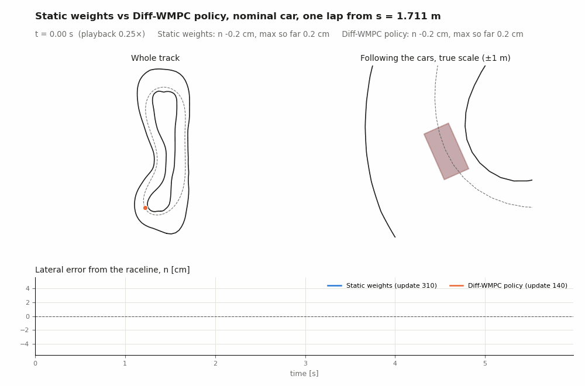
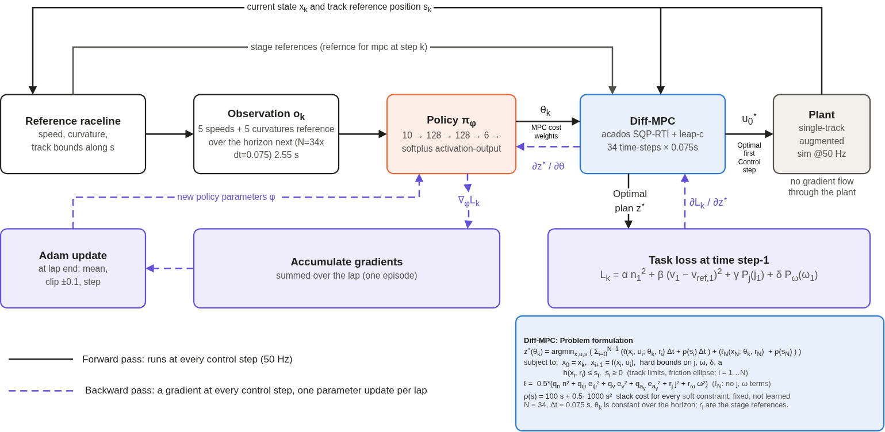
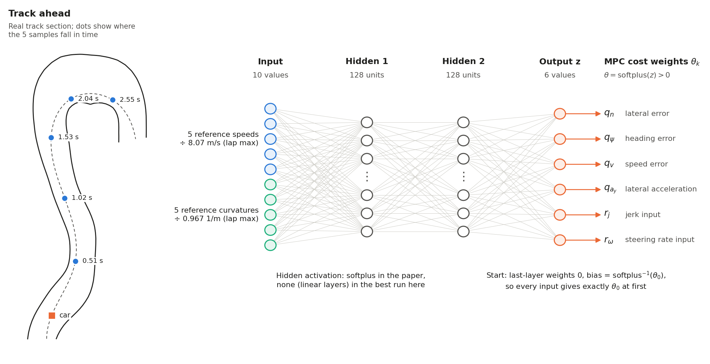
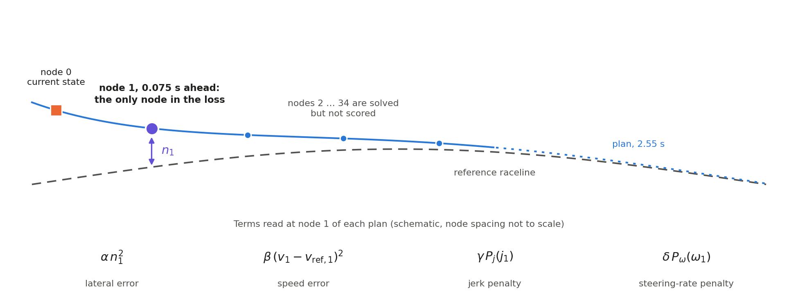
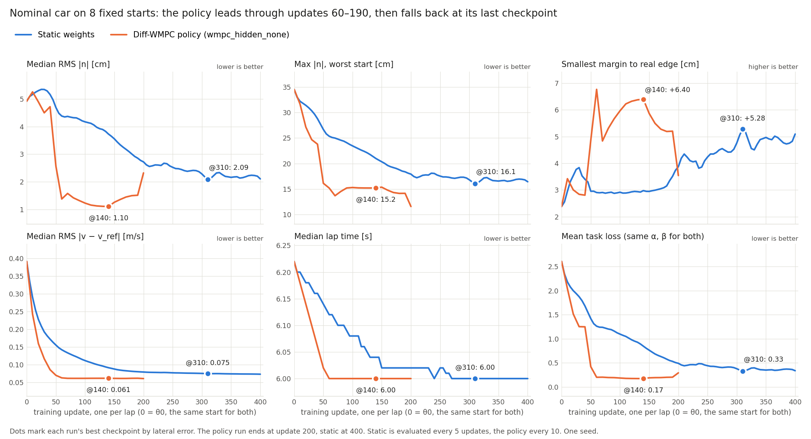

<!-- Author: Prajwal Thakur <prajwalthakur98@gmail.com> -->

# Diff-WMPC architecture

Diff-WMPC learns how to tune a model predictive controller (MPC) while it drives. A small neural network looks at the
track ahead and sets the MPC's cost weights at every control step. The network is trained by differentiating through
the MPC solver.

This is a reimplementation of *Differentiable Weights-Varying Nonlinear MPC via Gradient-Based Policy Learning: An
Autonomous Vehicle Guidance Example* (Jahncke et al., IEEE RA-L, vol. 11, no. 3, 2026), applied to a small racing car
in simulation. [Differences from the paper](#differences-from-the-paper) lists where it departs from the original.

## Training loop



**At every control step (50 Hz):**

1. Read 5 speeds and 5 curvatures from the reference raceline over the next 2.55 s. This is the observation $o_k$.
2. The policy turns $o_k$ into six cost weights, $\theta_k = \pi_\phi(o_k)$.
3. The MPC solves for a horizon plan $z^\star$ using those weights. Its first input $u^\star_0$ drives the car.
4. The loss $L_k$ scores time-step-1 of the plan.
5. Backpropagation adds $\nabla_\phi L_k$ to the accumulated gradient.
6. The plant advances to the next state.

**At the end of each lap:** the accumulated gradient is averaged over the lap's steps, clipped element-wise to ±0.1, and
applied with Adam. If the solver failed during the lap, the policy returns to its last feasible parameters and Adam
restarts.

## Policy network




The observation comes from the reference alone, not from the car's current error. With linear hidden layers, the network
is an affine map of the observation followed by the softplus. One $\theta_k$ applies to the whole horizon of a solve; the
weights vary from one solve to the next.

Because the policy starts at $\theta_0$, its last-layer bias plays the same role as the weight vector in a static
Diff-MPC run. With the learning rate of the other layers set to 0, a policy run reproduces the static run to 4e-15.

## MPC

The MPC is a nonlinear single-track model solved with acados (SQP-RTI, one iteration per control step) and wrapped by
[leap-c](https://github.com/leap-c/leap-c) for differentiation. It has 34 time steps spaced 0.075 s apart, integrated with RK4.

- **State:** $x = [X, Y, \psi, v_x, v_y, r, \delta, a]$
- **Input:** $u = [j, \omega]$ (jerk and steering rate)

**Cost**, where the learned weights appear:

$$
\ell(x, u; \theta) = \tfrac{1}{2}\left(
q_n\, n^2 + q_\psi\, e_\psi^2 + q_v\, e_v^2 + q_{a_y}\, e_{a_y}^2 + r_j\, j^2 + r_\omega\, \omega^2
\right)
$$

The terminal cost uses the same expression without the two input terms.

| Weight | Penalizes | Definition | $\theta_0$ |
|---|---|---|---|
| $q_n$ | Lateral error | $n$, signed distance from the raceline | 50 |
| $q_\psi$ | Heading error | $\psi - \psi_\mathrm{ref}$ | 2.9 |
| $q_v$ | Speed error | $v_x - v_\mathrm{ref}$ | 2 |
| $q_{a_y}$ | Lateral acceleration error | $v_x r - a_{y,\mathrm{ref}}$ | 5 |
| $r_j$ | Jerk | $j$ | 0.01 |
| $r_\omega$ | Steering rate | $\omega$ | 6.8 |

**Constraints**, which are fixed and never learned:

- **Hard bounds:** jerk ±50 m/s³, steering rate ±3.2 rad/s, steering angle ±0.698 rad, acceleration from −8.64 to 9.51 m/s².
- **Soft limits:** track bounds tightened by 3 cm on each side, and a friction ellipse. Violations have fixed penalties
  (100 linear, 1000 quadratic).

## Loss

<!--  -->

$$
L_k = \alpha\, n_1^2 + \beta\,(v_1 - v_{\mathrm{ref},1})^2 + \gamma\, P_j(j_1) + \delta\, P_\omega(\omega_1)
$$

All four terms are read at node 1 of the plan. The two input terms use a threshold penalty, quadratic up to the threshold
and exponential beyond it:

$$
P(x) =
\begin{cases}
x^2 & \lvert x \rvert \le x_\mathrm{th} \\
x_\mathrm{th}^2 + e^{\kappa (\lvert x \rvert - x_\mathrm{th})} - 1 & \lvert x \rvert > x_\mathrm{th}
\end{cases}
$$

| Term | Coefficient in the reported runs | How it was set |
|---|---|---|
| Lateral, $\alpha$ | 416.49 | $1 / 0.049^2$, where 0.049 m is the RMS lateral error at $\theta_0$ |
| Speed, $\beta$ | 6.57 | $1 / 0.39^2$, where 0.39 m/s is the RMS speed error at $\theta_0$ |
| Jerk, $\gamma$ | 0 (off) | Threshold 8 m/s³, $\kappa$ = 0.15 when enabled |
| Steering rate, $\delta$ | 0 (off) | Threshold 0.25 rad/s, $\kappa$ = 0.8 when enabled |

Dividing by each term's variance makes the terms dimensionless, so both contribute about 1 at a typical $\theta_0$ error.

## How the gradient reaches the policy

$$
\nabla_\phi L_k =
\underbrace{\frac{\partial L_k}{\partial z^\star}}_{\text{loss at node 1}}\;
\underbrace{\frac{\partial z^\star}{\partial \theta}}_{\text{solver sensitivity}}\;
\underbrace{\frac{\partial \theta}{\partial \phi}}_{\text{backprop in the network}}
$$

$$
\phi \leftarrow \mathrm{Adam}\left(\phi,\ \mathrm{clip}_{\pm 0.1}\left(\frac{1}{K} \sum_{k=1}^{K} \nabla_\phi L_k\right)\right)
$$

where $K$ is the number of valid control steps in the lap.

- **Solver sensitivity:** the solver finds how the optimal solution (in our case optimal-trajectory) changes when the weights change. This is computed by leap-c and
  acados, and the plan at time-step(node) 1  depends on the whole horizon, so all 34 nodes affect the result even though only node
  1 is scored.
- **No gradient through the plant:** each $x_k$ is treated as a constant. The gradient shows how $\theta_k$ changes the plan
  from the current state, not how it changes the states the car reaches later.
- **Approximate derivatives:** with SQP-RTI, the plan is not a fully converged solution, so the sensitivities are
  approximate. The paper trains the same way.

<!-- **A known weakness:** in our sensitivity check, $\theta$ moved $n_1$ 6–30× less than $v_1$. The gradient therefore sees
lateral error poorly at node 1 and tends to lower $q_n$. This is the likely reason the softplus-hidden network drove $q_n$
to about 1e-14 and left the track, and why early stopping is needed. -->

## Training settings

| Setting | Value |
|---|---|
| Starting weights | $\theta_0$ = (50, 2.9, 2, 5, 0.01, 6.8) |
| Episode | One lap from a random start, seed 0 |
| Updates | One per lap, 200 laps |
| Optimizer | Adam, element-wise clip ±0.1 |
| Learning rates | 0.1 on the last-layer bias, 1e-3 on all other parameters |
| Best checkpoint | Update 140, chosen on 8 fixed evaluation starts |

From the workspace root, after `source install/setup.bash`:

```bash
python3 src/rl_framework/experiments/diff_weight_mpc/utils/train_mpc.py \
    --model policy --hidden-activation none --weight-param softplus \
    --laps 200 --lr 0.1 --lr-net 1e-3 --loss-importance 1 1 0 0 --seed 0 --tag wmpc_hidden_none
```

## Differences from the paper

| | Paper | This implementation |
|---|---|---|
| Vehicle and track | Full-scale racecar, Monza | Small racing car (0.58 m long), 27.4 m track, simulation only |
| Hidden activation | Softplus | Both tried; softplus collapsed and linear layers gave the best result |
| Loss coefficients | Bayesian optimization: $\alpha$ = 2.5e-5, $\beta$ = 2.25, $\gamma$ = 2.5e-7, $\delta$ = 9e-3 | Normalized by error size, input terms off |
| Threshold penalty | Jumps at the threshold | Made continuous |
| Gradient batch | 10 control steps | One lap (about 300 control steps) |
| Learning rate | 2.9e-5 | 0.1 on the bias, 1e-3 on other parameters |
| Starting weights | (2.5, 2.9, 2, 5, 4.3, 6.8) | (50, 2.9, 2, 5, 0.01, 6.8) |

## Results

Nominal car, 8 fixed starts, one lap each. Both runs have the same starting weights, loss and seed.

| | Static weights, update 310 | Policy, update 140 |
|---|---|---|
| RMS lateral error | 2.09 cm | **1.10 cm** |
| Smallest margin to the track edge | +5.28 cm | **+6.40 cm** |
| RMS speed error | 0.075 m/s | **0.061 m/s** |
| Lap time | 6.00 s | 6.00 s |
| RMS steering rate | **0.30 rad/s** | 0.70 rad/s |

<!-- This comes from one seed and from the linear-hidden network only, and it needs early stopping. See
[conclusion.md](conclusion.md) for the checkpoint comparison and the limits of the result. -->

## Code

| Part | File |
|---|---|
| Training loop, optimizer, CLI | [train_mpc.py](../utils/train_mpc.py) |
| Policy network | [policy_network.py](../learning/policy_network.py) |
| Loss | [loss.py](../learning/loss.py) |
| MPC cost and constraints | [ocp.py](../mpc/ocp.py) |
| MPC wrapper | [controller.py](../mpc/controller.py) |
| Closed-loop rollout | [closed_loop.py](../closed_loop.py) |
| Evaluation on fixed starts | [eval_checkpoints.py](../utils/eval_checkpoints.py) |
<!-- | Figures in this page | [architecture_figures.py](architecture_figures.py) | -->
