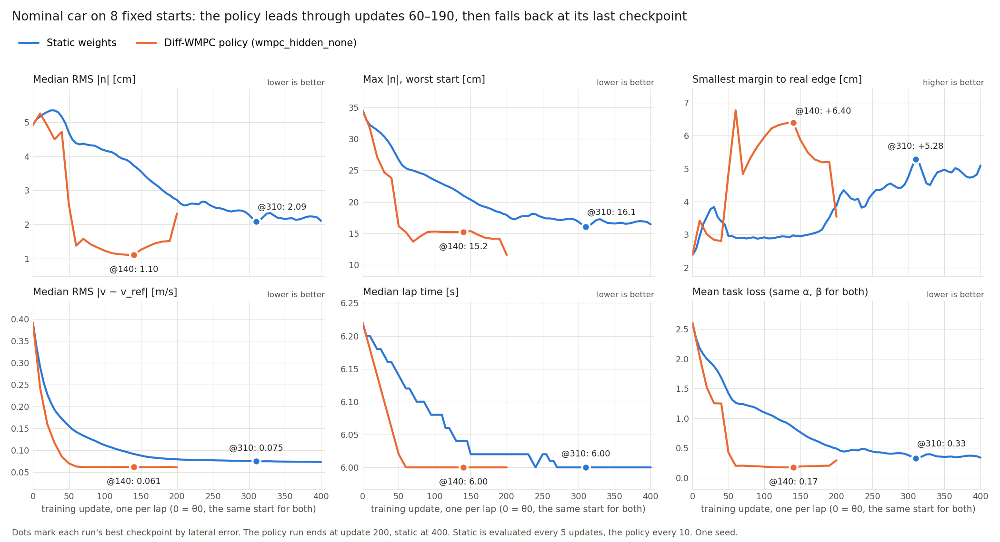

# Conclusion: Diff-WMPC policy vs static weights, nominal car

**On the nominal car, the Diff-WMPC policy beats the best static weights.** At its best checkpoint (update 140), the
policy has about half the lateral error of static's best (1.10 vs 2.09 cm RMS), keeps 1.1 cm more from the track edge
(+6.40 vs +5.28 cm), and has about 19 % lower speed error (0.061 vs 0.075 m/s). Lap time ties at 6.00 s. The lead
needs early stopping, and it costs more than twice the steering rate.

## Checkpoints

The policy is better than static's best on lateral error and speed error at every checkpoint from update 60 to 190.
Margin is less clear-cut: 10 of those 14 checkpoints beat static's best, one ties it, and three fall just short
(+4.84 to +5.20 cm). Static reaches its level more slowly, and from update 320 on its lateral error stays between 2.10
and 2.33 cm with no trend.

| Run | Update | Laps finished | RMS \|n\| [cm] | Max \|n\| [cm] | Margin [cm] | RMS \|v − v_ref\| [m/s] | Lap [s] | Loss |
|---|---|---|---|---|---|---|---|---|
| Start (θ0, both runs) | 0 | 8/8 | 4.92 | 34.5 | +2.38 | 0.391 | 6.22 | 2.60 |
| Static | 200 | 8/8 | 2.72 | 17.9 | +3.88 | 0.079 | 6.02 | 0.49 |
| **Static (best)** | **310** | 8/8 | **2.09** | **16.1** | **+5.28** | 0.075 | 6.00 | **0.33** |
| Static (last) | 400 | 8/8 | 2.10 | 16.4 | +5.09 | 0.073 | 6.00 | 0.34 |
| Policy | 60 | 8/8 | 1.38 | 15.2 | +6.76 | 0.063 | 6.00 | 0.20 |
| **Policy (best)** | **140** | 8/8 | **1.10** | **15.2** | **+6.40** | **0.061** | 6.00 | **0.17** |
| Policy | 190 | 8/8 | 1.51 | 14.1 | +5.20 | 0.061 | 6.00 | 0.20 |
| Policy (last) | 200 | 8/8 | 2.32 | 11.6 | +3.54 | 0.061 | 6.00 | 0.29 |

"Best" is the lowest RMS |n| on these fixed starts. Max |n| is the worst single start. Margin is the closest the car's
side came to the real track edge. Loss is the training loss with the same coefficients for both runs.

## What the policy's lead costs

Median across the 8 starts, from the baseline suite:

| Run | Worst \|n\| on a typical start [cm] | Steering rate RMS [rad/s] | Peak steering rate [rad/s] | Commanded jerk RMS [m/s³] |
|---|---|---|---|---|
| Static @310 | 5.3 | 0.30 | 0.76 | 15.4 |
| Static @400 | 5.4 | 0.30 | 0.75 | 15.5 |
| Policy @140 | 2.9 | 0.70 | 2.54 | 15.9 |
| Policy @200 | 6.4 | 0.74 | 2.33 | 15.8 |

The loss has no steering term in these runs, so nothing held the policy's steering rate down.

## Setup

| | Static | Policy |
|---|---|---|
| Run | `theta0_sp1e-1_lat1_v1_400` | `wmpc_hidden_none` |
| Start θ0 | (50, 2.9, 2, 5, 0.01, 6.8) | same |
| Loss | α = 416.49, β = 6.57, γ = δ = 0, node 1 | same |
| Weight map, optimizer | softplus, Adam, clip ±0.1, one update per lap | same |
| Learning rate | 0.1 | 0.1 on the last-layer bias, 1e-3 on the rest of the network |
| Seed (random training starts) | 0 | 0 |
| Length | 400 laps | 200 laps |

Evaluation for both: 8 evenly spaced fixed starts, one lap each, 3 cm MPC track margin. Static checkpoints were
evaluated every 5 updates, the policy's every 10.

## Limits

- **Early stopping is needed.** The policy drops sharply between updates 190 and 200 (1.51 → 2.32 cm, +5.20 → +3.54
  cm). Static shows no such drop within 400 laps, and its last checkpoint beats the policy's last on lateral error and
  margin.
- **One seed.** A second seed is the most useful next check.
- **Checkpoint selection used the same starts as this report,** for both runs.
- **This is the linear-hidden network only.** The paper's network with softplus hidden layers (`wmpc_main`) collapses
  in this setup: it completes 1 of 8 laps at update 200.
- **Nominal car only.** With the MPC given the true friction on the μ × 0.8 car, policy @140 completes 2 of 8 laps
  where static completes all 8.
- **The reason for the gain is still open.** The policy's important weights vary only ×1.3–1.4 along the lap. Part of
  its lead may come from shrinking the minor weights faster than static does, not from varying weights along the track.

## Data

- Static: `data/train_static/theta0_sp1e-1_lat1_v1_400/checkpoint_eval.csv`,
  `data/closed_loop/baseline_suite_theta0_sp1e-1_lat1_v1_400{,_u310}/`
- Policy: `data/train_policy/wmpc_hidden_none/checkpoint_eval.csv`,
  `data/closed_loop/baseline_suite_wmpc_hidden_none{,_u140}/`
